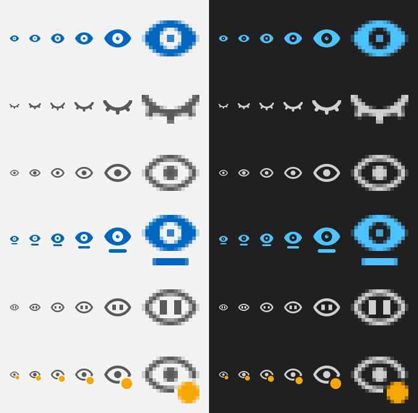

# ai-keep-awake

Keep a Windows laptop awake while an AI agent (Claude Code) is working, and let it sleep, and lock, as
normal otherwise.

A long Claude Code task can run for half an hour with nobody touching the keyboard. Windows counts only
keyboard and mouse input as activity, so on a laptop that sleeps after a few minutes the session is
suspended mid-task. Claude Code keeps a Mac awake while it works (`caffeinate`), but does nothing on Windows.

This tool uses Claude Code's own hooks to know when a session is working, and holds a named Windows power
request ("An AI agent is working (Claude Code)") only for that time. It needs no admin rights, never changes
a Windows setting, and never fakes input. A tray icon shows what it's doing and why. It's three small native
programs (4 to 6 MB each), with nothing else to install first.

## Install

1. Download the zip from [Releases](https://github.com/gareth-jones-zen/ai-keep-awake/releases)
   (`ai-keep-awake-<version>-win-x64.zip`, from the release marked Latest).
2. Right-click it, **Extract All**, and **double-click `ai-keep-awake.exe`** in the extracted folder. Windows may
   warn that it's from an unknown publisher (it isn't code-signed): **More info**, then **Run anyway**.
3. It says what it will change, and asks once:

```
This will:
  - copy its programs to C:\Users\you\AppData\Local\Programs\ai-keep-awake
  - add its hooks to C:\Users\you\.claude\settings.json (7 events; the file is backed up first)
  - start its watcher, and its tray icon, at each logon (Task Scheduler; the Run key)
  - add it to the Start menu, and to Settings > Apps so it can be uninstalled there
No admin rights needed. Nothing else on the laptop is changed.

Install? [Y/n]
```

The tray icon may start in the overflow (^) by the clock: Windows lets only you bring it out, in **Settings >
Personalisation > Taskbar > Other system tray icons**. The unzipped folder isn't used after that, so it can be
deleted.

From a terminal it's the same `install` (`.\ai-keep-awake.exe install --dry-run` shows exactly what it would change
first). Inside Claude Code it does everything but the logon entries, and prints the one command for you to run.

`install` doesn't change your PATH. From then on, either run the installed copy by its full path:

```powershell
& "$env:LOCALAPPDATA\Programs\ai-keep-awake\ai-keep-awake.exe" status
```

or add `%LOCALAPPDATA%\Programs\ai-keep-awake` to your user PATH and type `ai-keep-awake`, as the rest of this
README does.

| To | Do |
|---|---|
| Upgrade | Extract the new release and double-click its `ai-keep-awake.exe` ("Upgrade 1.1.0 to 1.2.0? [Y/n]"), or run its `install`. It replaces the installed programs, even while hooks are running the old ones, and restarts the watcher and the tray. The tray says when a new release is out (below); it never installs one itself |
| Uninstall | **Settings > Apps > ai-keep-awake > Uninstall**, or `ai-keep-awake uninstall`. It takes out the hooks, the task and the tray at logon, the Start menu and Settings > Apps entries and the leases, and deletes the programs. It keeps your settings file and the log (`--purge` deletes them), and `install.json`, which notes that you removed it |
| Check | The tray icon; or `ai-keep-awake status` |

### The three programs

| Program | What it's for |
|---|---|
| `ai-keep-awake.exe` | The commands, with output. What you run; double-clicked, the guided install |
| `ai-keep-awake-background.exe` | No window, ever. What the hooks and the logon task run, so nothing flashes up on every tool call |
| `ai-keep-awake-tray.exe` | The tray icon and its window (below). Started at logon, and by the Start menu's ai-keep-awake |

### SmartScreen, and checking a download

The programs aren't code-signed, so Windows SmartScreen may warn the first time a downloaded copy is started
from Explorer. To check that a download is the one GitHub Actions built from this repo, each release has a
`SHA256SUMS.txt` (for the zip and the three programs) and a signed build provenance attestation:

```powershell
Get-FileHash .\ai-keep-awake-<version>-win-x64.zip -Algorithm SHA256    # compare with SHA256SUMS.txt
gh attestation verify .\ai-keep-awake-<version>-win-x64.zip --repo gareth-jones-zen/ai-keep-awake
```

`sha256sum -c SHA256SUMS.txt --ignore-missing` works too, from Git Bash or WSL.

## How it works

**Hooks write a lease per session.** `install` adds command hooks to your Claude Code user settings, so every
project is covered. Each runs `ai-keep-awake-background.exe hook <action>`, which keeps one small file per
session in `%LOCALAPPDATA%\ai-keep-awake\leases\`:

| Hook | What it does |
|---|---|
| UserPromptSubmit, PreToolUse, SubagentStart | A 15-minute lease. Skipped if it was renewed under a minute ago, so a burst of tool calls costs one write |
| Stop | If `background_tasks` has anything still running (a background shell or subagent), a 45-minute background lease; otherwise the lease goes, because the turn is over |
| Notification `idle_prompt`, StopFailure | The lease goes, unless it's a background lease (`idle_prompt` fires while background work is still running) |
| SessionEnd | The lease goes |

A crash, or a terminal closed without SessionEnd, leaves a lease that simply expires. The lease records
Claude Code's process id, and the watcher ignores a lease whose process has gone.

**The watcher holds one power request** while any lease is live, the laptop is on mains, and someone has
used the keyboard or mouse in the last 3 hours. It runs at logon (the Task Scheduler task
`ai-keep-awake watch`), one copy at a time, and checks every 15 seconds. The task restarts it if it crashes,
and never stops it for time. If the 3-hour cap lets the laptop sleep while sessions are still working, it
says so once, in a notification; it also notifies if a check fails three times in a row. Otherwise it's
silent. The log is `%LOCALAPPDATA%\ai-keep-awake\ai-keep-awake.log`, with `started`, `holding`, `released`,
`locked` and an hourly `alive`.

**Windows still decides the rest.** Closing the lid, pressing the power button or choosing Sleep still
sleeps it: Windows ends power requests then, by design. On battery Windows ends the request about five
minutes after the sleep timeout anyway, so by default the watcher doesn't hold it on battery at all. The
display still turns off as normal, and the screensaver still starts. Windows also drops the request when the
watcher exits, so a crash can't leave the laptop awake.

While it's held, `powercfg /requests` (in an admin terminal) shows the request by name.

## Keeping it awake by hand, and pausing

Two controls, for the times the hooks can't know about:

| Command | What it does |
|---|---|
| `ai-keep-awake awake 2h` | **Keep awake now**, for a time (`30m`, `1h`, `2h`, up to `24h`): a download or a build carries on while you're at lunch. It follows **the same rules as a Claude Code session**: mains only, the 3-hour cap, and locking where Windows would. `awake off` stops it |
| `ai-keep-awake pause 1h` | **Pause**: the laptop sleeps as normal for that long, even while Claude works (a train to catch, a laptop going in a bag). `pause on` pauses until `pause off`; a pause never outlives a logoff |

Each turns the other off. Keep awake now is a lease of its own kind (`manual.json` in the leases folder); a pause is
`pause.json` beside the state file. Either tells the watcher at once (a named event), rather than at its next
15-second check. `status` shows them as `By hand:` and `Paused:` lines.

## The tray icon

The icon is an eye: open while the laptop is kept awake, closed when it sleeps as normal. It shows the state, and
its tooltip says why:

| Icon | State | Tooltip, for example |
|---|---|---|
| Open eye, blue | Keeping the laptop awake for Claude | "ai-keep-awake: awake for 2 Claude Code sessions (on mains). Locks after 10 min idle." |
| Open eye, blue, with a bar under it | Kept awake by hand | "ai-keep-awake: kept awake by hand until 16:00." |
| Closed eye, grey | Not needed | "ai-keep-awake: no Claude Code session is working; normal sleep." |
| Hollow eye, grey | Not keeping awake though Claude is working | "ai-keep-awake: on battery, so not keeping awake" |
| Hollow eye with a pause mark | Paused | "ai-keep-awake: paused until 15:00; normal sleep." |
| Hollow eye with an amber dot | Something's wrong | "ai-keep-awake: the watcher isn't running" |



**Click it** for a small window: what it's doing and since when, each Claude Code session (its project folder,
working or background, until when), when it locks and why, **Keep awake now** and **Pause**, **Start at logon**
(the watcher's task and the tray, together), and links to the full status, the log and the settings file. A
problem shows in place of the headline with the one thing to do: **Start it** (the watcher), or **Put them back**
(the hooks, through `install --hooks-only`). **Right-click** for the same controls in a menu, and to close the icon
(the watcher carries on).

The window and the menus follow Windows: light or dark, your accent colour, a high contrast theme and the text
size (Settings > Accessibility), each as soon as you change it. The window has no title bar: **Escape**, Alt+F4
or a click anywhere else closes it. **Tab** and Shift+Tab (or the arrow keys) go round its controls, and Enter or
Space presses the one in focus.

In the tray, Keep awake now can also be **until I turn it off**: a short lease tied to the tray's process and
renewed each minute, so closing the tray ends it. The watcher's two notifications (the 3-hour cap; checks
failing) come from the tray, as "ai-keep-awake", when it's running.

**New releases:** once a day the tray asks GitHub for the latest release (a public repo: no account, no token)
and, if it's newer, the window shows "1.3.0 is available" with a link. It never downloads or installs anything.
It doesn't ask at all when another installer manages it (`install --managed-by right-hand`): then that installer
decides the version.

The tray reads the watcher's files (`state.json`, the leases, the pause file) every two seconds and acts through
the same files and commands as the command line, so the watcher never waits on it. If the tray isn't running,
nothing changes but the icon.

## Locking: where Windows would have locked

Keeping a laptop awake must not keep it unlocked. Without the request, an idle laptop locks at the first of:

1. **sleeping, when waking needs a sign-in**: the sleep timeout for the current power source, plus the
   "Require sign-in" grace;
2. **a secure screensaver**: active, "on resume, display logon screen", a screensaver chosen, and a timeout;
3. **the machine inactivity limit**, a security policy.

**While it holds the request, the watcher locks the session (as Windows+L does) at the earliest of these.**
If none applies (sleep set to never, no secure screensaver, no inactivity limit), Windows would never have
locked, and neither does the watcher. It locks once per idle stretch. **It doesn't lock while another program
is keeping the display on**, such as a call, a video or a presentation, because then Windows wouldn't have
slept or started the screensaver either.

The values are read from Windows every minute, so a change in Settings applies straight away:

| Value | Where it's read |
|---|---|
| Sleep after, display off after | The active power plan, for the current power source (`PowerReadACValueIndex` / `PowerReadDCValueIndex`); a Group Policy value under `HKLM\SOFTWARE\Policies\Microsoft\Power\PowerSettings` wins; `powercfg /query` as a fallback. 0 means never. If the sleep timeout can't be read, the display timeout is assumed, then 5 minutes |
| Sign-in on wake | Settings > Accounts > Sign-in options, "If you've been away, when should Windows require you to sign in again?". **On Modern Standby** that's `DelayLockInterval` in `HKCU\Control Panel\Desktop` (0 every time, a number of seconds, or 0xFFFFFFFF never; missing is taken as every time). **On other machines** it's the "require a password on wakeup" power setting (CONSOLELOCK). A Group Policy value for that setting wins on either |
| Screensaver | `SystemParametersInfo`, which gives the effective active, secure and timeout values, Group Policy included; the screensaver program from the policy key, then the user's own |
| Machine inactivity limit | `InactivityTimeoutSecs` under `HKLM\SOFTWARE\Microsoft\Windows\CurrentVersion\Policies\System` |
| Another program keeping the display on | `CallNtPowerInformation(SystemExecutionState)`, which needs no admin rights (unlike `powercfg /requests`) |

`ai-keep-awake status` shows each value, where it came from, and the lock point they give. To lock at a fixed
point instead, set `lock = 10` (minutes) in the settings; `lock = "never"` turns locking off.

## Commands

```
ai-keep-awake [--config CONFIG] <command>

ai-keep-awake                             double-clicked in Explorer: the guided install (from a terminal: this help)
ai-keep-awake install [--dry-run] [--settings PATH] [--install-dir PATH] [--no-autostart] [--hooks-only]
                      [--managed-by WHO]
ai-keep-awake uninstall [--dry-run] [--settings PATH] [--no-autostart] [--purge] [--interactive] [--managed-by WHO]
ai-keep-awake status [--json]             hooks, watcher, leases, the power request, and the lock point from Windows
ai-keep-awake awake 1h|2h|30m|off         keep the laptop awake by hand for that long (as a session would be)
ai-keep-awake pause 1h|on|off             let the laptop sleep as normal, even while Claude works
ai-keep-awake config                      create the settings file (if missing) and say where it is
ai-keep-awake autostart on|off|status     the watcher's logon task and the tray's Run entry, together
ai-keep-awake watch                       the watcher itself (what the logon task runs)
ai-keep-awake hook busy|stop|idle|end     what the hooks run (reads the hook's JSON on stdin)
ai-keep-awake --version
```

| `install` option | What it does |
|---|---|
| `--dry-run` | Shows the copy, the change to `settings.json` as a diff, and the task; changes nothing |
| `--settings PATH` | Another Claude Code settings file |
| `--install-dir PATH` | Another folder for the programs, for this run. To make it stick, set `install_dir` in the settings too, so `status` and `autostart` look there |
| `--no-autostart` | Nothing at logon: the programs, the hooks, the Start menu and Settings > Apps entries and `install.json`; no task and no Run entry. A watcher or tray already running this install's programs is still restarted on the new ones |
| `--hooks-only` | Only the hooks: put them back in `settings.json` |
| `--managed-by WHO` | Who installed it, recorded in `install.json`: `right-hand` when that kit installs it (the tray then doesn't look for releases). Without it an upgrade keeps what was recorded, else `person` |

| `uninstall` option | What it does |
|---|---|
| `--dry-run` | Shows the change to `settings.json` and what else it would remove |
| `--no-autostart` | Leaves the watcher's task, and so the programs it runs |
| `--purge` | Deletes the settings file, the log and the state file too |
| `--interactive` | Asks once first, and waits for Enter at the end: what Settings > Apps runs |
| `--managed-by WHO` | Who's removing it. Without it (or as `person`), `install.json` records that you removed it, so an installer that manages it (right-hand) asks you rather than quietly putting it back |

**Inside Claude Code** (`CLAUDECODE` set, as Claude Code does in the shells it runs), `install` does everything but
the logon entries (the task, and the tray's Run entry), and prints the one command for you to run at a console:
Claude Code's permission check blocks registering them, rightly. A watcher task that's already registered is
restarted on the new programs.

**`status --json`** gives the same facts as `status` for programs to read (`format` 1; times in Unix seconds):
`hooks` (installed, events), `watcher` (running, its task), `request` (held, why, from the watcher's state file),
`paused`, `manual`, `leases`, `power`, `lock`, `windows`, `rules`, `tray` (running, at logon) and `install`
(`install.json`). The text lines stay as they are, since scripts read them too.

Exit codes: 0 done, 1 failed, 2 bad arguments or settings, 3 a second watcher (it doesn't start).

### What `install` changes

**Only its own entries in `settings.json`.** It backs the file up first
(`settings.json.ai-keep-awake-<yyyyMMdd-HHmmss>.bak`, beside it, never over an earlier backup), refuses a file
that isn't valid JSON, adds each hook in a matcher group of its own, and leaves every other key and every other
hook as it was. Its entries are found by their shape: a command hook that runs `ai-keep-awake.exe` or
`ai-keep-awake-background.exe` with `hook` as the first argument. Running `install` again replaces them rather
than adding more, and `uninstall` removes exactly those. If Claude Code writes the file while `install` is
changing it, the change is made again on the new contents rather than losing that write. A symbolic link (a
dotfiles setup) is written through to the file it points at.

Each hook looks like this:

```json
{
  "type": "command",
  "command": "C:\\Users\\you\\AppData\\Local\\Programs\\ai-keep-awake\\ai-keep-awake-background.exe",
  "args": ["hook", "busy"],
  "timeout": 15
}
```

The hooks run the program directly, in exec form (`args`, no shell), so there's no console window. The hook
never reads the settings file, always exits 0 and never prints, because Claude Code reads a hook's output as
context or a decision. A call takes about 40 ms. The 15-second timeout is well over that because the first
run of a newly installed exe waits for Microsoft Defender to scan it, and a hook that Claude Code kills writes
no lease.

**Beyond the hooks**, a full install adds, all per user (no admin rights):

| What | Where | Removed by `uninstall` |
|---|---|---|
| The watcher at logon | The Task Scheduler task `ai-keep-awake watch` | Yes |
| The tray at logon | `HKCU\Software\Microsoft\Windows\CurrentVersion\Run`, `ai-keep-awake` (Task Manager > Startup apps lists it) | Yes |
| The Start menu's ai-keep-awake (opens the tray's window), with an AppUserModelID so its notifications are its own | `%APPDATA%\Microsoft\Windows\Start Menu\Programs\ai-keep-awake.lnk` | Yes |
| Settings > Apps: name, version, size, icon, and Uninstall | `HKCU\Software\Microsoft\Windows\CurrentVersion\Uninstall\ai-keep-awake` | Yes |
| `install.json`: the version, when, who installed it (`managed_by`: `person` or `right-hand`), and `removed_by_person` once uninstalled | `%LOCALAPPDATA%\ai-keep-awake\` (beside the state file) | Kept, noting the uninstall |

If Settings > Apps already lists a copy in another folder that's still there, an install elsewhere leaves the Start
menu and Settings > Apps entries alone; `start_menu = false` in the settings leaves them out altogether (a test
copy, say).

**The programs are copied in a way that works while they're running.** Every open session runs the installed
`ai-keep-awake-background.exe` on each tool call, and a running exe can't be overwritten. So `install` stops the
watcher (and closes the tray), copies each program in as `.new`, renames the old one aside to `.old` and moves the
new one into place. A failure puts back anything already swapped, so the install is never half old and half new, and the
watcher is started again as it was. Leftover `.old` files are deleted by the next install. Each new program is run
once (`--version`), so Defender's first-run scan happens then rather than on the first hook call.

**Uninstall deletes the programs** too: only its own three (and any `.old` beside them), and the folder if that
leaves it empty. Run from the installed copy (as Settings > Apps does), a copy of it in `%TEMP%` waits for it to
exit, deletes them, and then itself.

**Already-open sessions** pick up new hooks when Claude Code next reads its settings; a new session certainly
will. Registering the logon task needs you at the console.

## Settings

Every setting has a default, so no file is needed. `ai-keep-awake config` creates
`%APPDATA%\ai-keep-awake\config.toml` with them all commented out. To use another file, pass `--config`, or
set `AI_KEEP_AWAKE_CONFIG`.

```toml
reason = "An AI agent is working (Claude Code)"   # what powercfg /requests shows
lease_minutes = 15                      # one prompt or tool call keeps it awake this long
background_lease_minutes = 45           # after a turn ends with background work still running
unattended_hours = 3                    # stop keeping it awake after this long with no keyboard or mouse
mains_only = true
lock = "windows"                        # "windows", "never", or a number of minutes
check_seconds = 15
check_pid = true                        # ignore a lease whose Claude Code process has gone
leases_dir = "%LOCALAPPDATA%/ai-keep-awake/leases"
log_file = "%LOCALAPPDATA%/ai-keep-awake/ai-keep-awake.log"
state_file = "%LOCALAPPDATA%/ai-keep-awake/state.json"
claude_settings = "~/.claude/settings.json"
install_dir = "%LOCALAPPDATA%/Programs/ai-keep-awake"
start_menu = true                       # install adds it to the Start menu and Settings > Apps
```

Paths may use `~` and `%VARIABLES%`; a relative path is relative to the settings file. An unknown setting is
an error, so a typo doesn't pass silently. The hooks carry the lease lengths, the leases folder and the
install folder, so after changing any of those, run `install` again.

**To leave one run out**, set `AI_KEEP_AWAKE=0` in its environment (`off`, `false` and `no` work too): the hook
then does nothing. Headless `claude -p` runs fire user hooks too, so a scheduled run keeps the laptop awake
while it works unless you opt it out.

## Edge cases

| Case | What happens |
|---|---|
| Several sessions at once | One lease each; held while any is live |
| Esc mid-turn | Stop doesn't fire; `idle_prompt` clears the lease about a minute later, or it expires |
| A tool or model call longer than 15 minutes | Covered up to 15 minutes from the last renewal (the Bash tool's limit is 10) |
| API error or usage limit | StopFailure clears the lease |
| `/loop` and scheduled wake-ups | Deliberately not kept awake between wake-ups |
| A background shell that never ends | Bounded by the 45-minute lease and the 3-hour cap |
| Upgrading while sessions are working | The running programs are renamed aside, not overwritten; see *What `install` changes* |
| The first hook call after an install | Can wait a few seconds for Defender's scan; the 15-second timeout covers it |
| A second watcher started by hand | Logs that one is already running, and exits with code 3 |
| The tray crashes or is closed | The icon goes; a keep-awake "until I turn it off" ends with it; the watcher carries on |
| The watcher stops | The tray shows it, and offers to start it |
| `state.json` stale (over 3 minutes) | The tray says "status unknown since 14:05" rather than guessing |
| A pause left behind | It ends at its time, or when the watcher next starts (never past a logoff) |
| Explorer restarts | The tray puts its icon back |

## Building from source

You need the .NET 11 SDK (`global.json` pins the feature band). Native AOT publishing also needs the Visual
Studio C++ build tools ("Desktop development with C++"), with `vswhere.exe` on the PATH.

The Windows calls come from the `WinBackground` library in
[background-tools-lib](https://github.com/gareth-jones-zen/background-tools-lib), shared with other tools.
Check it out beside this repo, so the two folders sit side by side (for example `source\repos\ai-keep-awake` and
`source\repos\background-tools-lib`); the build references it there. To build against a checkout somewhere
else, pass `-p:BackgroundToolsLib=<its folder>`. The workflows check out its `main` beside this repo.

```powershell
git clone https://github.com/gareth-jones-zen/background-tools-lib ..\background-tools-lib
dotnet build -c Release
dotnet test -c Release
dotnet publish src/AiKeepAwake.Console -c Release -r win-x64 -o publish
dotnet publish src/AiKeepAwake.Background -c Release -r win-x64 -o publish
dotnet publish src/AiKeepAwake.Tray -c Release -r win-x64 -o publish
.\publish\ai-keep-awake.exe install --dry-run
```

`install` needs the three programs side by side, as `publish` leaves them. Pushing a tag such as `v1.0.0` (or
`v1.0.0-rc.1`, which becomes a pre-release) runs the release workflow, which tests, publishes, zips, writes
`SHA256SUMS.txt` and attests the build.

| Folder | What's in it |
|---|---|
| `src/AiKeepAwake` | The hook, watcher, lock point, install and commands; what the tray shows (`TrayView`) and its icons (`IconArt`, which also wrote `src/app.ico`) |
| `src/AiKeepAwake.Console` | `ai-keep-awake.exe` |
| `src/AiKeepAwake.Background` | `ai-keep-awake-background.exe` |
| `src/AiKeepAwake.Tray` | `ai-keep-awake-tray.exe`: hand-written Win32 (the icon, owner-drawn menus, a window drawn with GDI), so it stays Native AOT with no UI framework. `AI_KEEP_AWAKE_THEME=light` or `dark` in its environment shows it in that theme whatever Windows is set to, for looking at the other one and for screenshots |
| `docs/design` | The icon's contact sheets (`icon/`, drawn by the tests), and the notes and screenshots of each pass over the tray's look |
| `..\background-tools-lib\src\WinBackground` | The Windows calls: power requests, settings, Task Scheduler, notifications, locks, the log (with its own tests, in that repo) |
| `tests/AiKeepAwake.Tests` | xUnit tests, with fakes for Windows, Claude Code, the desktop (Run key, Settings > Apps, Start menu, tray), GitHub and the clock; a few run the built programs in a second process. After changing `IconArt`, `AI_KEEP_AWAKE_WRITE_ICON=1 dotnet test` writes `src/app.ico` and the contact sheets in `docs/design/icon` afresh |
