# The tray's look, November 2026

A pass over the tray icon, its window and its menus after 1.2.1: what was wrong, what changed, and what was left.
Behaviour is unchanged: the same states, the same controls, the same files and commands behind them.

All screenshots are of the built `ai-keep-awake-tray.exe` at 125% scaling, run against a folder of made-up state
(three sessions, a pause, no watcher...), with `AI_KEEP_AWAKE_THEME` choosing the theme. "Before" is 1.2.1.

## The icon

An eye: open while the laptop is kept awake, closed when it sleeps as normal. Before, it was a filled disc or a
ring, which said "on" or "off" but nothing about what.

| State | Before | Now |
|---|---|---|
| Keeping awake for Claude | Blue disc, white dot | Open eye, blue |
| Kept awake by hand | Blue disc, clock hands | Open eye, blue, with a bar under it (held open) |
| Not needed | Grey ring | Closed eye, grey |
| Not keeping awake though Claude is working | Grey ring, dot | Hollow eye, grey |
| Paused | Grey ring, pause mark | Hollow eye, pause mark |
| Something's wrong | Grey ring, amber dot | Hollow eye, amber dot |

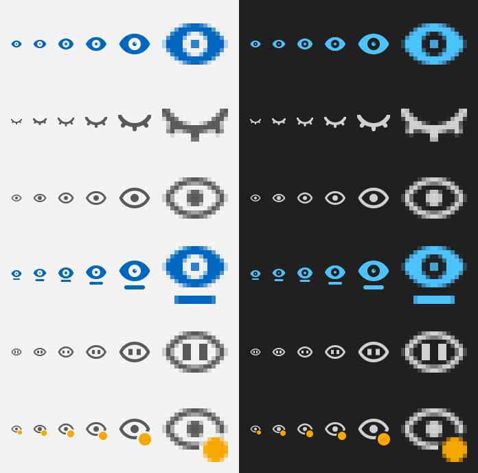

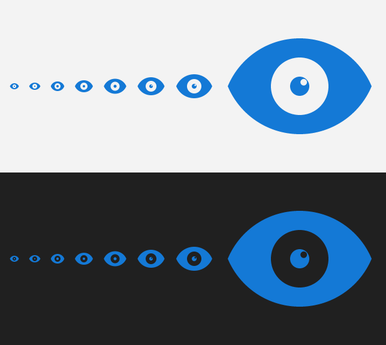

- Drawn in code (`src/AiKeepAwake/IconArt.cs`), as before; `AI_KEEP_AWAKE_WRITE_ICON=1 dotnet test` writes
  `src/app.ico` and these two sheets (`docs/design/icon`).
- Up to 32 px every measure is a whole pixel, so the lids, the iris and the bars sit on pixel edges.
- The iris is cut out rather than painted white, so the taskbar shows through: one drawing reads on light and dark.
- The program icon (Start menu, Settings > Apps) is one blue, `#1479D6`, that has 3.6:1 or better on both.

## The menus

| | Before | Now |
|---|---|---|
| Dark | 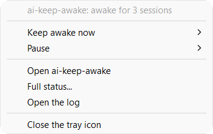 | 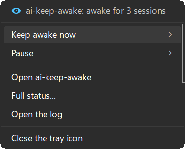 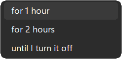 |
| Light |  | 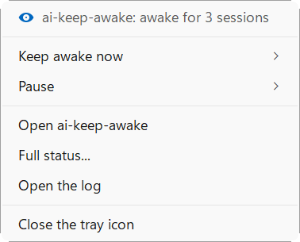 |
| Paused | | 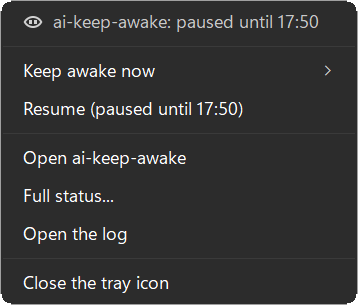 |

Windows draws a Win32 popup menu light whatever the app's theme, and has no supported switch for it. Three ways
round that, and why the second was taken:

| | How | For | Against |
|---|---|---|---|
| 1 | `SetPreferredAppMode` and `FlushMenuThemes` (uxtheme ordinals 135 and 136) | Windows' own dark menu, edge and all; a few lines | Undocumented, exported by number only; has changed meaning between Windows 10 builds |
| 2 | **Owner-drawn items over a background brush** (`MF_OWNERDRAW`, `SetMenuInfo`) | All documented; still Windows' menu (keys, submenus, timing); the type and spacing match the window | The menu's one-pixel edge stays Windows' mid grey in dark; first-letter keys and screen-reader text are put back by hand (`WM_MENUCHAR`, `MSAAMENUINFO`) |
| 3 | A window of our own in place of the menu | Every pixel ours | Keyboard, submenus, dismissal and accessibility all to rebuild, and to keep right |

With a high contrast theme on, the menus are not owner-drawn at all: Windows' own menu is already right.

## The window

| | Before | Now |
|---|---|---|
| Awake, light | 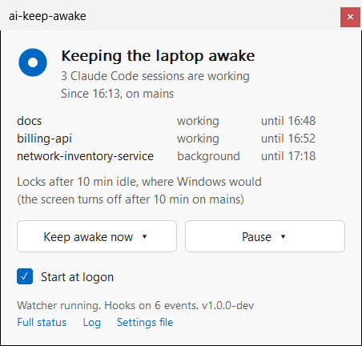 | 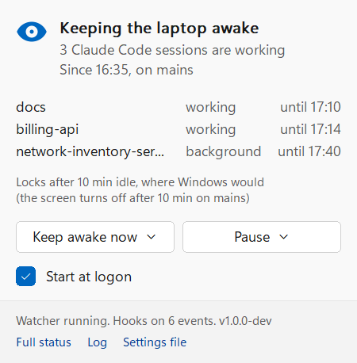 |
| Awake, dark | 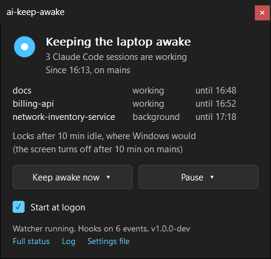 | 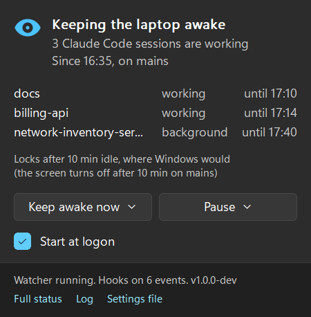 |
| By hand, dark | 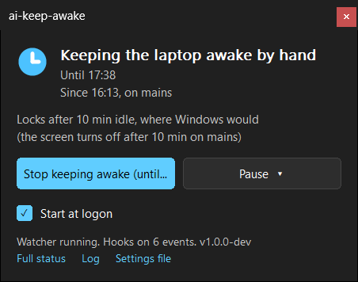 | 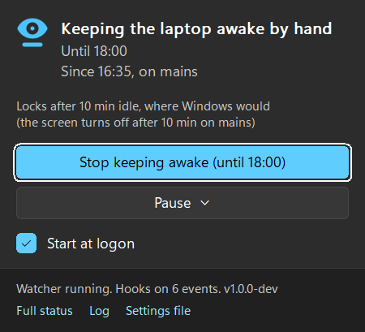 |
| A problem, light | 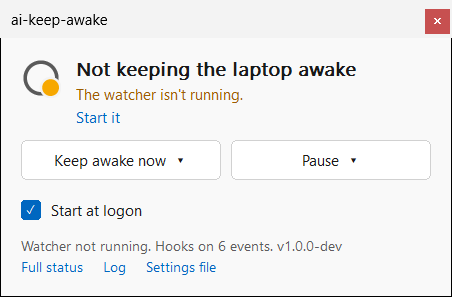 | 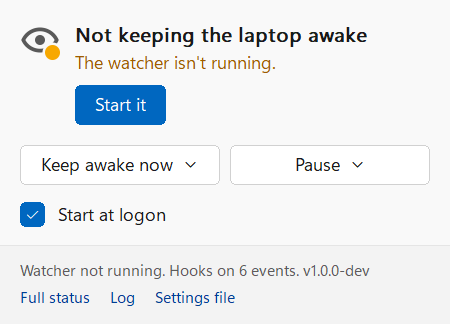 |

More of now: [by hand, light](after-light-manual-window.png), [a problem, dark](after-dark-problem-window.png),
[paused](after-dark-paused-window.png), [not needed](after-light-idle-window.png),
[on battery](after-light-blocked-window.png), [the keyboard's focus ring](after-light-keyboard-window.png).

What was found, and what was done:

| Found | Done |
|---|---|
| A tool window's title bar and close button on what is a flyout by the clock | No title bar; Windows 11's rounded corners and shadow. Escape, Alt+F4 or a click elsewhere closes it, as before |
| 12 px text in Segoe UI: small beside Windows 11's own | 14 px body and 12 px captions in Segoe UI Variable (Segoe UI before Windows 11); a 16 px semibold headline |
| "Stop keeping awake (until 16:00)" cut short in half the width | The two buttons go one above the other when a label doesn't fit |
| A long line cut short with "..." | It wraps onto a second line |
| The session columns at fixed places | The last two columns as wide as their text, "until" lined up on the right; the name has the rest |
| Accent colour fixed at Windows' default blue | The person's accent colour, moved towards the text colour only if it wouldn't have 4.5:1 as a link or 3:1 as a fill; black or white on it, whichever reads |
| No keyboard beyond Escape | Tab, Shift+Tab and the arrows go round the controls; Enter or Space presses; a focus ring once the keyboard is used |
| Nothing for a high contrast theme, or for Settings > Accessibility > Text size | Windows' colours when high contrast is on; the whole window scales with the text size |
| Only light/dark changes were picked up while running | The accent, high contrast and text size too, as soon as they change |
| "▾" and "✓" typed as characters | The chevrons and the tick from Windows' icon font (Segoe Fluent Icons; Segoe MDL2 Assets before Windows 11) |
| A hand pointer over everything | A hand over links only; buttons keep the arrow, and show hover and pressed |
| "Start it" a link under the warning | A filled button: it's the one thing to do |
| The watcher's line and the links run on from the controls | A footer strip, as Windows 11's flyouts have |
| A click acted on whatever was under the pointer at release | Press and release on the same control; sliding off lets go |
| The window had no name beyond "ai-keep-awake" | Its title is the state ("ai-keep-awake: awake for 3 sessions"), which is what a screen reader says when it opens |

Left as it was, on purpose:

- **The wording.** Every label and line is as it was.
- **No animation.** Nothing here needs one, and the window should be there the moment it's asked for.
- **Not checked on a screen:** the high contrast colours, a text size above 100%, and scalings other than 125%
  (the icon's sheets cover its sizes; the window's measures all go through the one scaling function, as before).

Still to do, if wanted:

- **A screen reader can't read inside the window.** It is drawn, not built of controls, so there is nothing for
  UI Automation to walk. The title, the tooltip and the right-click menu say the state and offer every control;
  the fix proper is a UI Automation provider (or real child controls), which is a piece of work of its own.
- **The menu's edge in dark** (the table above): route 1 would darken it, at the price given there.
